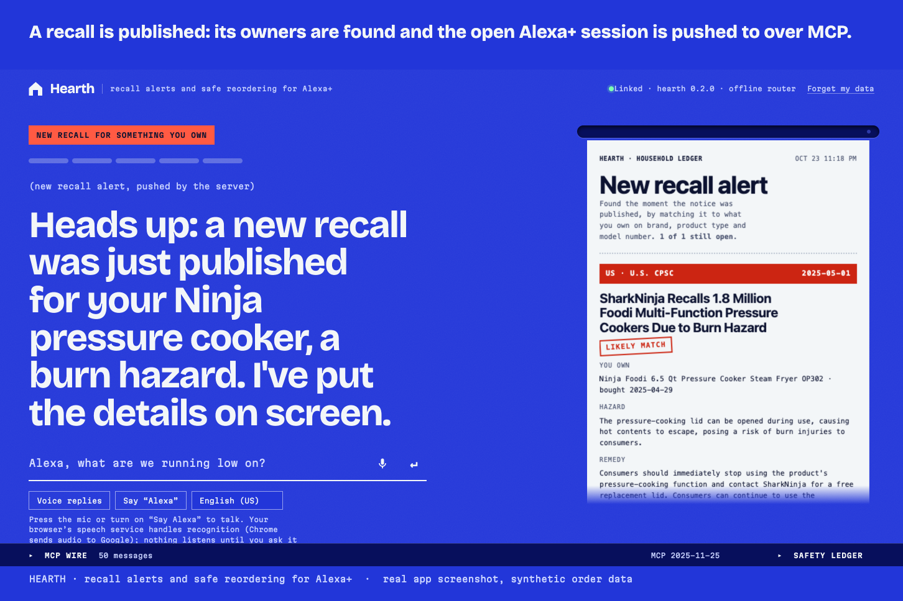
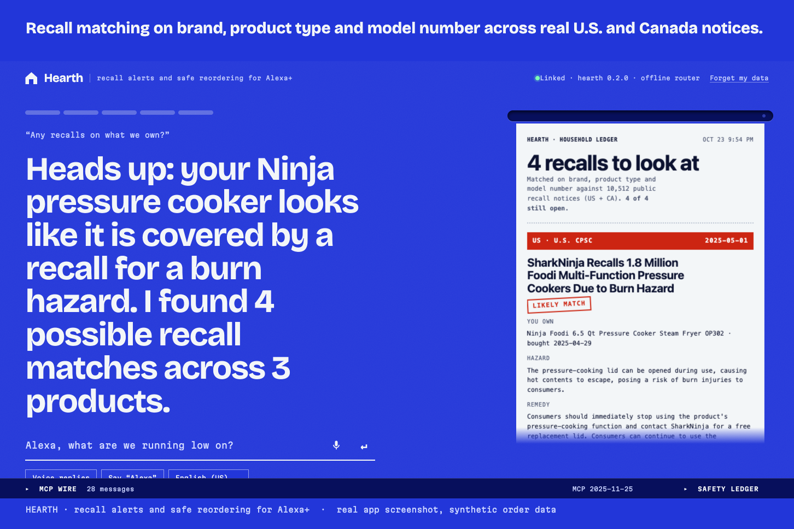
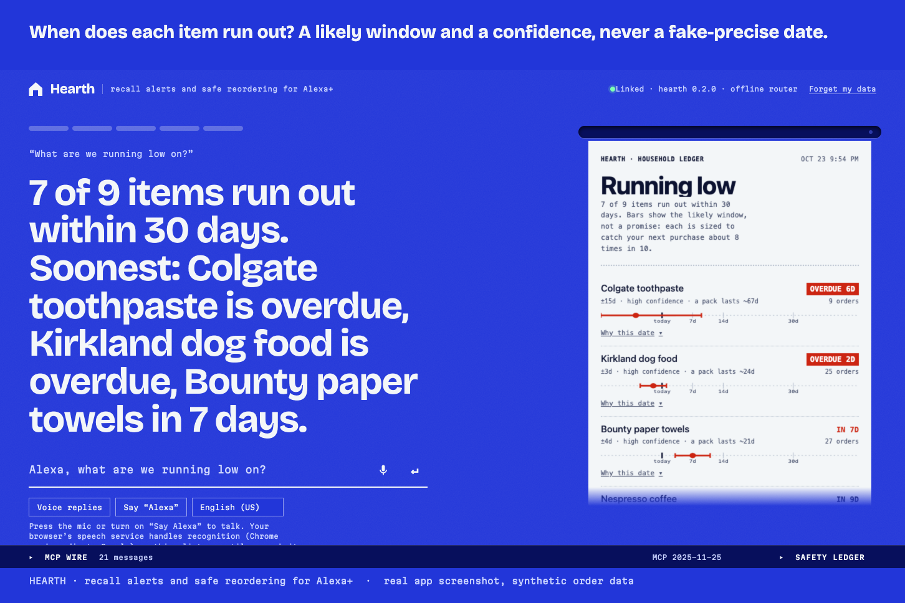
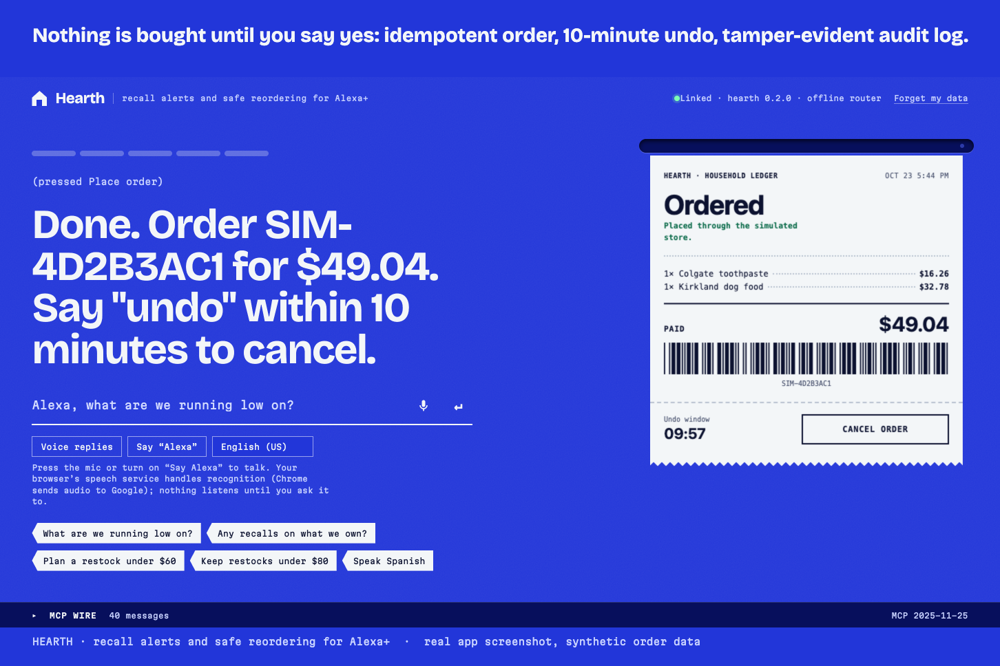
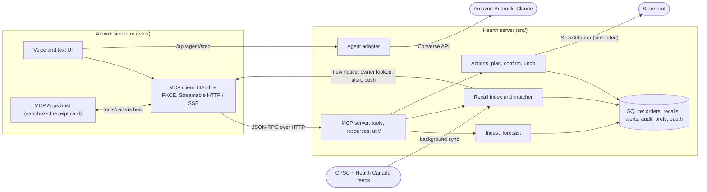
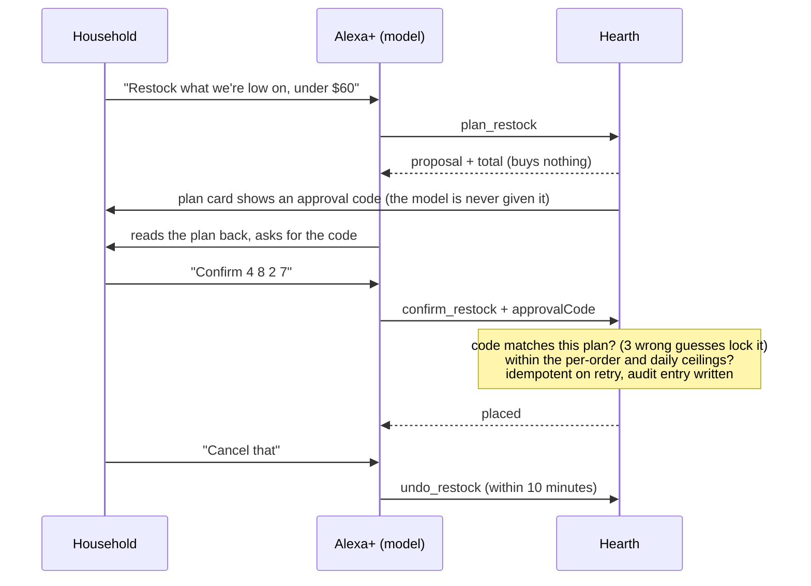

<div align="center">



# Hearth

### Recall alerts and safe reordering for Alexa+

Hearth is an Alexa+ add-on that tells a household **the day a product they own is recalled**,
and that **never spends their money without an explicit, undoable yes**.

[](https://modelcontextprotocol.io)
[](https://modelcontextprotocol.io)
[](SECURITY.md)
[](package.json)
[](#tests)
[](SECURITY.md)
[](LICENSE)

[**For judges**](JUDGING.md) · [Run it](#run-it) · [How it works](#how-it-works) · [Security](SECURITY.md) · [Evidence](docs/PROBLEM.md) · [Scale](docs/SCALE.md)

</div>

> Built for the **Amazon "Build, Ship, Shape" Developer Hackathon**, Alexa+ track, with the AWS Builder mini-challenge (Claude on Amazon Bedrock).

---

## The problem

Two gaps meet in the kitchen.

**Recalls do not reach owners.** CPSC's own FY2025 report puts the correction rate across consumer-product recalls at 44.55%, and regulators are now
ordering marketplaces to notify buyers directly. The notice exists; the person holding the product never sees it.

**Agents that can spend money have no standard safety pattern.** Alexa+ add-ons will be able to reorder what a household runs out of. Nothing says
how much, how often, how to confirm, or how to take it back.

Hearth is a reference implementation of both answers, as one self-hosted **MCP server**. The evidence, and what is *not* claimed, are in
[docs/PROBLEM.md](docs/PROBLEM.md).

## What it does

<table>
<tr>
<td width="50%" valign="top">

### Tells owners the day a recall is published
A background sync spots **new** notices from the U.S. CPSC and Health Canada (10,000+ real notices), finds every household that owns the
product through a brand index, stores an alert, and **pushes** `notifications/resources/updated` over MCP to their open Alexa+ sessions.
Matches carry their evidence, and only a **model-number hit** is called `likely`.

</td>
<td width="50%" valign="top">

### Spends money only with a clear, reversible yes
`plan_restock` only proposes. To order by voice, the person must read out a **4-digit approval code that appears only on the plan card**:
a model has no way to say "the user agreed", so a prompt-injected one cannot place an order. Orders sit under **operator-set ceilings the
model cannot change**, with a 10-minute `undo_restock` and a hash-chained audit log.

</td>
</tr>
</table>

Hearth is **not a store**. It restocks only what the household already buys regularly, and it says so plainly if asked for a laptop.

<table>
<tr>
<td></td>
<td></td>
</tr>
<tr>
<td align="center"><sub><b>Pushed the moment a notice is published</b></sub></td>
<td align="center"><sub><b>Matched on brand, product type and model number</b></sub></td>
</tr>
<tr>
<td></td>
<td></td>
</tr>
<tr>
<td align="center"><sub><b>Runway forecast with a window and a confidence</b></sub></td>
<td align="center"><sub><b>Receipt card (MCP App) with working Place / Cancel buttons</b></sub></td>
</tr>
</table>

<sub>Real screenshots of the running app. The order data in them is synthetic; the recalls are real.</sub>

### Highlights

| | |
|---|---|
| **Owner-level matching** | Brand, product type and model number against 10,505 real notices. Measured on 1,669 cases built from real notices: **85.4%** surfaced, **0%** false alerts on unrelated products of the same brand, **2.1%** wrong-model false "likely". |
| **Learns from messy data** | Imports order exports as they really arrive: mixed date formats (day-first detected), many currencies in the right minor unit, duplicates, cancellations, missing quantities, retitled products. Streams files of hundreds of thousands of rows on a worker thread. |
| **Forecasts with error bars** | Median days-per-unit across purchase gaps, robust to stock-ups; reported as a likely window with a confidence, never a fake-precise date. |
| **Consent a model cannot forge** | No `userConfirmed` flag to set. The model's only route to an order needs a code only the on-screen card shows (stored hashed, three wrong guesses lock the plan). **Attacked on purpose:** `npm run redteam` hits the live model with 16 prompt injections while a plan is pending and counts the orders placed ([docs/REDTEAM.md](docs/REDTEAM.md)). |
| **A forecast you can audit** | `npm run backtest` predicts every purchase from the history before it. The stated window is calibrated so the real next purchase falls inside it about 80% of the time (it was 56% before the backtest caught it); run it on your own export. |
| **Safe by construction** | Spend ceilings, idempotency, undo, audit chain, an erase tool hidden from the model, and a tested attack suite ([SECURITY.md](SECURITY.md)). |
| **Speaks the household's language** | English, Spanish and Hindi replies, locale-correct money, preferences that persist. Spoken conversation with a wake word and follow-ups ([docs/VOICE.md](docs/VOICE.md)). |
| **Real protocol, visible** | A real MCP client (OAuth + PKCE, Streamable HTTP/SSE, MCP Apps host) stands in for the device, with a live **MCP wire** drawer showing every JSON-RPC message. |
| **Claude on Amazon Bedrock** | Optional brain via the Converse API with tool use, verified live with Claude Haiku 4.5, with retries and a daily call cap ([docs/BEDROCK.md](docs/BEDROCK.md)). |

> **What is simulated.** Alexa+ add-on tooling is partner-only, so there is no real device: the web page in `web/` is a **real MCP client**
> standing in for it, which the hackathon FAQ allows. The storefront is a simulated `StoreAdapter`; no real purchases occur.
> The three sample households in `data/` (US home, family with a baby, India in ₹ with day-first dates) are **synthetic**.
> The recall data is **real**. You can also import your own order export from the page.

## Run it

Requires **Node 22.16+** (uses the built-in `node:sqlite`). No AWS account is needed.

```bash
npm install
npm start          # http://localhost:3939   (MCP endpoint: /mcp)
```

Open <http://localhost:3939>, then:

1. **Link Hearth to Alexa+**, a real OAuth 2.1 + PKCE flow.
2. **Load sample order history** (pick a household) or **Use my own export**.
3. Ask: *"what are we running low on?"*, *"any recalls on what we own?"*, *"plan a restock under $60"*.
4. Press **Place order** on the card, then **Cancel order**. Open **MCP wire** to watch the protocol.

**See a recall arrive live.** Start with an operator token, keep the page open, and replay a real notice:

```bash
HEARTH_ADMIN_TOKEN=<24+ characters> npm start
HEARTH_ADMIN_TOKEN=<same> npm run demo:recall -- Foodi
```

**Use it from any MCP client:**

```bash
HEARTH_AUTH=off npm start          # local experiments only; refuses to start in production
claude mcp add --transport http hearth http://localhost:3939/mcp
```

**Use Claude on Bedrock as the brain** (optional). With AWS credentials in the environment, the simulator's reasoning runs on Claude through the Converse API.
Without them it uses a small deterministic offline router, so everything runs for judges with no account.
Check your setup with `npm run bedrock:check`. Details and the cost guard: [docs/BEDROCK.md](docs/BEDROCK.md).

## How it works



**The recall pipeline.** Every 30 minutes the server syncs the public feeds into a local index. A notice not seen before is matched to
owners through a reverse brand index (1,250 owners of one product among 5,000 households in 37 ms), an alert is stored, and the owner's open
session receives `notifications/resources/updated`. History is never reported as "new", and replaying a notice never duplicates an alert.

**The safety pattern.**



Key decisions: the browser is the MCP client (judges see real protocol traffic); the model runs server-side so AWS credentials never reach
the browser; the receipt card runs in an opaque-origin sandboxed iframe and can only call tools the server marks visible to apps; purchasing
sits behind one `StoreAdapter` interface, which is the seam where a real ordering API plugs in.

### Tools

| Tool | What it does | Annotations |
|---|---|---|
| `import_order_history` | Clean and load a CSV export; re-import is a no-op | idempotent |
| `household_runway` | Forecast per item with ± window and confidence | read-only, UI |
| `recall_alerts` | Recalls published since the household last looked that match something they own (push + pull) | UI |
| `check_recalls` | Match owned durables to the local U.S. + Canada recall index, with evidence | read-only, UI |
| `plan_restock` | Propose an order within budget, in the household's currency; buys nothing | UI |
| `confirm_restock` | Place a planned order; needs the approval code the person read off the card | destructive, idempotent |
| `approval_code`, `approve_restock` | **Card only, hidden from the model:** show the code on the plan card; the **Place order** button | destructive, idempotent |
| `undo_restock` | Cancel within 10 minutes | destructive, idempotent |
| `remember_preference` | Persist budget, skip-item, language (en/es/hi), recall regions (US/CA) | idempotent |
| `delete_household_data` | Erase everything held for the household (app-only, hidden from the model) | destructive |
| `activity_log` | Transparent, hash-chained history of what Hearth did | read-only |

An **Agent Skill** teaching an assistant the plan → read back → confirm discipline is in [`skill/hearth/SKILL.md`](skill/hearth/SKILL.md).

## Security

Self-audited in several passes: **19 findings, each fixed and each with an attack test** (DNS rebinding, cross-site calls, CSRF on consent,
token replay and refresh reuse, tenant isolation, spend-ceiling bypass, SQL metacharacters, path traversal, hostile text in recall feeds,
resource exhaustion). Highlights: consent a prompt-injected model cannot forge (approval codes, red-teamed live), hashed tokens with rotating refresh and reuse
detection, per-grant households, hash-only CSP, owner-only database file, operator ceilings the model cannot change, app-only tools the model is never offered, and refusal to start with auth off in production.
Full table and method: [SECURITY.md](SECURITY.md). This is a self-audit, not a third-party penetration test.

## Tests

```bash
npm test         # 106 tests: unit, chaos, security, and end-to-end through the official MCP SDK client
npm run typecheck
```

The end-to-end suite starts the server and, with the SDK client, performs the full OAuth/PKCE flow (including a wrong-verifier rejection),
negotiates 2025-11-25, imports the messy CSV twice (second is a no-op), checks the forecast, matches the **real** SharkNinja Foodi recall,
enforces budget, refuses unconfirmed orders, proves retry idempotency, undoes, and exercises elicitation approve/decline. A stand-in Converse
server (HTTP/2) pins every bug found in the first live Bedrock run. The receipt view's inline script is compiled in a test because a typo there
fails silently inside the iframe.

```bash
npm run bench -- 5000 200     # 676k orders, 5,000 households: import, forecast and recall latency
npm run eval                  # precision/recall of recall matching on real notices
```

A 500k-row, 43.5 MB upload through `POST /api/import` took 12.4 s while concurrent requests stayed at p99 13 ms.
Tables and caveats: [docs/SCALE.md](docs/SCALE.md).

## Deploy

```bash
npm run build && npm run start:prod                  # compiled JS, no tsx at runtime
docker compose up --build                            # non-root, read-only filesystem, healthcheck
npm run backup -- backups/hearth-$(date +%F).db      # online, verified SQLite backup
```

`/healthz` and `/readyz` for probes, Prometheus `/metrics` behind a token, JSON request logs, graceful SIGTERM with a database checkpoint,
and CI that runs typecheck, build, tests and `npm audit`. Everything configurable is in [`.env.example`](.env.example); the runbook is
[docs/OPERATIONS.md](docs/OPERATIONS.md).

## Honest limitations

- No real Alexa+ device or add-on certification (tooling is partner-only); no real storefront (`StoreAdapter` is simulated).
- Bedrock was exercised live (Claude Haiku 4.5, one free-plan account; [docs/BEDROCK.md](docs/BEDROCK.md), [docs/REDTEAM.md](docs/REDTEAM.md)); CI runs it only against a stand-in server.
- The Dockerfile and compose file were written without Docker on the author's machine; the `docker` job in CI builds and smoke-tests the image, and that job runs on public repositories (see the badge for its latest result).
- OAuth is a minimal authorization server for demonstrating account linking. Its consent step does not authenticate a person; production delegates to the household's real identity provider.
- One node and SQLite. Scaling out means Postgres (data access is plain SQL in `src/`), a shared rate-limit store, and a pub/sub for the alert push. None of that is built.
- The synthetic households prove throughput, and the backtest checks the forecaster's statistics, not real shopping behaviour: run `npm run backtest -- your-export.csv` to see how it does on a real export. Spanish and Hindi strings need native-speaker review.
- The offline voice router understands English only; with the Bedrock brain Claude can interpret other languages, which is untested here.
- Recall matching is heuristic by design (it says `possible` when unsure). It is a prompt to check the product label, not a safety guarantee.
- Order exports with column names beyond those in `src/ingest.ts` need header synonyms added.

## Repository map

| Path | What is there |
|---|---|
| `src/` | MCP server, OAuth, ingest, forecast, recall index and matcher, actions, alerts, Bedrock adapter, security |
| `web/` | The Alexa+ simulator: MCP client, voice, MCP Apps host |
| `src/view.html` | The receipt card (an MCP App) |
| `skill/hearth/` | The Agent Skill |
| `test/` | 106 tests |
| `scripts/` | Sample generator, benchmarks, recall evaluation, backups, Bedrock checks, recall replay |
| `data/` | Synthetic sample households and recall snapshots |
| `docs/` | Problem evidence, scale, Bedrock, voice, operations, demo script, friction log, submission notes |

[PRODUCT.md](PRODUCT.md) and [DESIGN.md](DESIGN.md) record the product intent and the visual system.

## License

[MIT](LICENSE) © 2026 anshul23102
